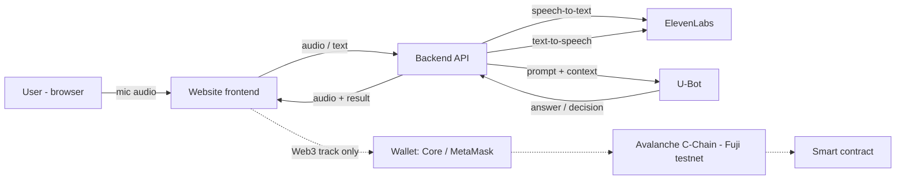

# Architecture

Generic shape for any idea in `01-brainstorm/`. Refine once the idea is chosen.

## Rules
- **API keys live only on the backend** (ElevenLabs, U-Bot). Never ship them to the browser.
- Build the happy path end-to-end first (voice in → U-Bot → voice out), then add Web3.
- Have a fallback: text input if the mic fails, pre-recorded audio if the API is slow.

## Typical demo data flow
1. User holds the mic button and speaks.
2. Backend sends audio to ElevenLabs speech-to-text → text.
3. Backend sends text + context to U-Bot → decision / reply.
4. (Web3) Frontend asks the wallet to sign the transaction on Fuji.
5. Backend sends the reply to ElevenLabs text-to-speech → audio.
6. Frontend plays audio and shows the result on screen.
