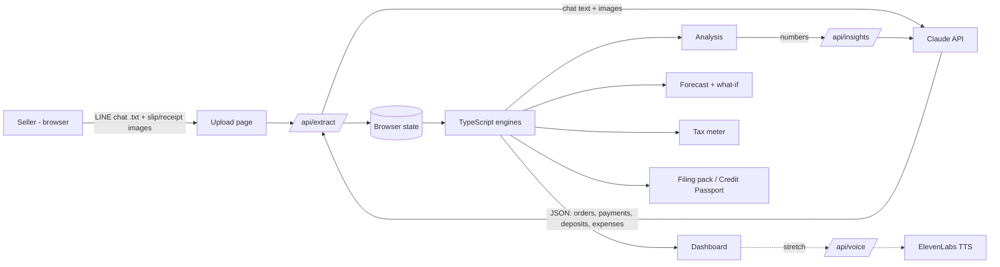

# Architecture — ChatCFO

> Primary input is now chat webhooks (LINE, Facebook, Instagram) — see [`capture-flows.md`](capture-flows.md). Upload below stays as fallback.



## Data model (shared between AI output and engines)

```ts
type Order    = { id: string; date: string; customer: string; items: { name: string; qty: number; price: number }[]; total: number; chatRef: string };
type Payment  = { id: string; date: string; customer: string; amount: number; slipImage?: string; orderId?: string; slipRef?: string };
type Deposit  = { id: string; date: string; amount: number; from: string; kind: "sale" | "personal" | "loan" | "refund"; reason: string; evidence: string };
type Expense  = { id: string; date: string; category: string; amount: number; receiptImage?: string };
type SlipFlag = { paymentId: string; issue: "duplicate" | "amount_mismatch" | "no_matching_order" | "suspected_edit"; detail: string };
```

## Engines (plain TypeScript, unit-testable)
| Engine | Input | Output |
|---|---|---|
| `books` | orders, payments, expenses | revenue, profit, receivables per customer |
| `slipGuard` | payments, orders | `SlipFlag[]` (duplicate ref, amount ≠ order, no order) |
| `analysis` | books | health score + reasons, product margins, late payers, churn risk, anomalies |
| `forecast` | daily cash series | 30/60/90-day cash + sales forecast (moving average + trend + weekday pattern), crunch date |
| `whatIf` | books + change (price %, cost, product drop) | new profit / cash / tax |
| `tax` | deposits, books, expenses | income (sales only), flat-60% vs actual tax, VAT countdown, e-Payment risk, deduction tips |
| `creditLimit` | payment history per customer | safe tab amount per customer |

## Rules
- API keys only on the server routes.
- AI never produces tax or forecast numbers — only extracted facts and wording.
- Ship a **seeded demo dataset** so the demo works even if upload or AI is slow.
- Every extracted item keeps `chatRef` / `evidence` so the seller (and the audit pack) can trace it back to the chat.
